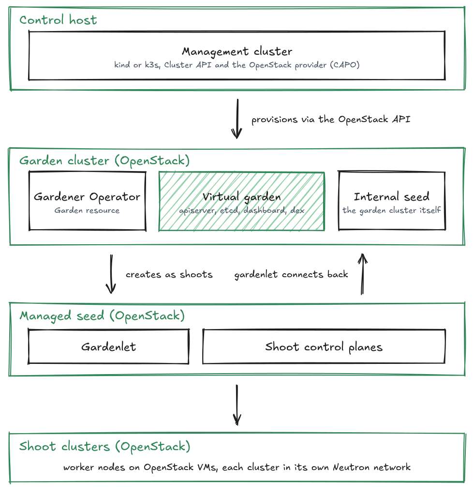

<p align="center">
  <picture>
    <source media="(prefers-color-scheme: dark)" srcset="docs/pages/assets/logo.svg">
    
  </picture>
</p>

<h1 align="center">YAKE.ansible</h1>

<p align="center">
  <strong>Gardener on OpenStack, from zero to a working landscape</strong>
</p>

<p align="center">
  Ansible automation for the YAKE platform: management cluster, Cluster API, garden cluster, Gardener Operator.
</p>

<p align="center">
  <a href="https://github.com/YAKEcloud/yake-ansible/releases/latest"></a>
  <a href="https://github.com/YAKEcloud/yake-ansible/actions/workflows/docs.yml"></a>
  <a href="https://github.com/YAKEcloud/yake-ansible/actions/workflows/build-container-images.yml"></a>
  <a href="LICENSE"></a>
  <a href="https://docs.renovatebot.com/"></a>
</p>

<p align="center">
  <a href="https://yake.cloud/">Documentation</a> &middot;
  <a href="#architecture">Architecture</a> &middot;
  <a href="#installation">Installation</a> &middot;
  <a href="#usage">Usage</a> &middot;
  <a href="#releases">Releases</a> &middot;
  <a href="https://yake.cloud">yake.cloud</a>
</p>

---

yake-ansible automates the deployment of a Gardener-based Kubernetes platform on OpenStack. It provisions a local management cluster, initializes Cluster API with the OpenStack provider, creates a dedicated garden cluster, and installs the Gardener Operator with cloud profiles, managed seeds, and all required extensions.

The result is a fully operational Gardener installation that can manage Kubernetes shoot clusters across one or more OpenStack tenants.

## Architecture

<p align="center">
  <picture>
    <source media="(prefers-color-scheme: dark)" srcset="docs/pages/assets/architecture-dark.svg">
    
  </picture>
</p>

See [docs/pages/architecture.md](docs/pages/architecture.md) for a detailed description of each layer and [docs/pages/networking.md](docs/pages/networking.md) for ports, IP ranges, and traffic flows.

## Requirements

- OpenStack tenant with sufficient quota (see [docs/pages/requirements.md](docs/pages/requirements.md#openstack-requirements))
- Python 3.13 or later on the control host
- Docker for the default install method

## Installation

```bash
python3 -m venv .venv
source .venv/bin/activate
pip install --upgrade pip
pip install -r requirements.txt
ansible-galaxy install -f -r requirements.yml
```

## Configuration

Copy `group_vars/all.yml.example` to `group_vars/all.yml` and fill in your values. At minimum, configure the OpenStack credentials, the garden URL, a cloud profile, and at least one managed seed.

See [docs/pages/configuration.md](docs/pages/configuration.md) for a complete variable reference.

## Usage

Run the full setup in one step:

```bash
ansible-playbook -i localhost, -c local site.yml
```

Or run individual steps using tags:

```bash
ansible-playbook -i localhost, -c local site.yml --tags kubectl
ansible-playbook -i localhost, -c local site.yml --tags helm
ansible-playbook -i localhost, -c local site.yml --tags clusterctl
ansible-playbook -i localhost, -c local site.yml --tags management-cluster
ansible-playbook -i localhost, -c local site.yml --tags clusterapi
ansible-playbook -i localhost, -c local site.yml --tags garden-cluster
ansible-playbook -i localhost, -c local site.yml --tags gardener
```

All plays are idempotent and can be re-run to apply configuration changes or upgrade components.

## Accessing Clusters

Kubeconfigs for all clusters are written to `/var/lib/yake/`. Tools installed by this project are available as wrapper scripts under `.local/`.

**Management cluster (CAPI host):**
```bash
export KUBECONFIG=/var/lib/yake/kubeconfig.clusterapi
./.local/yake-kubectl get nodes
```

**Garden cluster:**
```bash
export KUBECONFIG=/var/lib/yake/kubeconfig.garden
./.local/yake-kubectl get nodes
```

**Virtual Garden (Gardener API):**
```bash
export KUBECONFIG=/var/lib/yake/kubeconfig.garden
kubectl get secret gardener -n garden -o jsonpath='{.data.kubeconfig}' \
  | base64 -d > /var/lib/yake/gardener-operator/kubeconfig.vgarden
export KUBECONFIG=/var/lib/yake/gardener-operator/kubeconfig.vgarden
./.local/yake-kubectl get seeds
```

## Releases

Releases follow Gardener: `v1.155.1-0` is the first release for Gardener `1.155.1`, `-1`, `-2`, … are fixes to this repository. A new release is published automatically for every new Gardener version. The notes list the Gardener changes first, then the changes in this repository.

Each release is tested with its Gardener version, and that means the Gardener installation only. Seeds, shoots and everything else you run on top are outside the test scope.

Pin a release with `git checkout <tag>`. To run another Gardener version, set `gardener_operator_version` in your `all.yml`. This works, but is not tested. Only the newest Gardener version is maintained.

The minimum Gardener version is `1.142.0`. Since then, nginx-ingress is no longer deployed and all Gardener endpoints are served via the Istio ingress gateway. Older versions are not supported.

## Documentation

The documentation is also published at <https://yake.cloud/>.

| Document | Description |
|----------|-------------|
| [Architecture](docs/pages/architecture.md) | Layer model, component roles, and data flow |
| [Networking](docs/pages/networking.md) | Network topology, ports, IP ranges, DNS, VPN |
| [Requirements](docs/pages/requirements.md) | OpenStack quota and control host requirements |
| [Installation](docs/pages/getting-started.md) | Installation, configuration, first run |
| [Configuration](docs/pages/configuration.md) | Complete variable reference for all roles |
| [Operations](docs/pages/operations.md) | Upgrades, cleanup, troubleshooting |
| [How it works](docs/pages/overview.md) | Playbook flow, tags, and where the state lives |
| [Your first shoot cluster](docs/pages/first-shoot.md) | Create and use a shoot cluster |
| [Security](docs/pages/security.md) | Secrets, credentials, certificates, network isolation |
| [Releases](docs/pages/releases.md) | Versioning, tested scope, minimum Gardener version |
| [Scripts](docs/pages/scripts.md) | Image upload and OpenStack cleanup |
| [Glossary](docs/pages/glossary.md) | Gardener and Cluster API terms |

## Scripts

See [scripts/README.md](scripts/README.md) for auxiliary tools such as syncing CAPI and GardenLinux images to OpenStack Glance.
